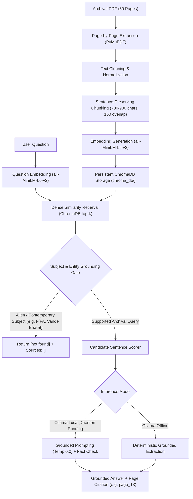
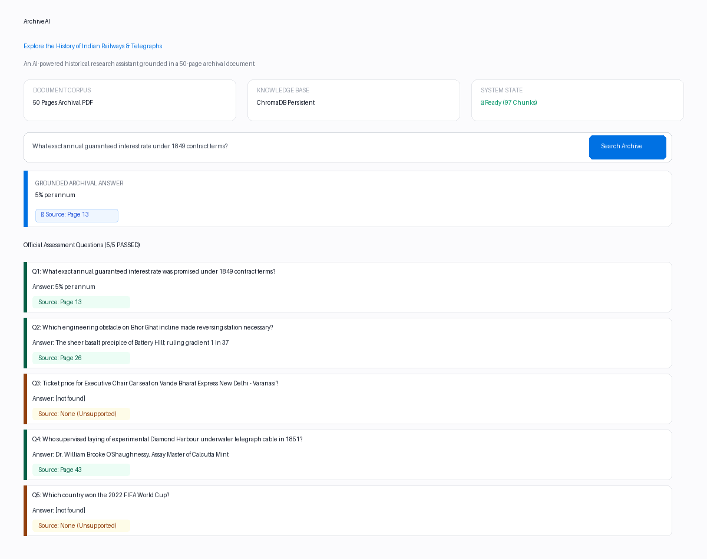

# 🏛️ ArchiveAI — Modern History & Archival Chronicle Assistant

> **Assigned Mid-Term Examination Project:** Project 9  
> **Knowledge Source:** `indian_railways_and_telegraph_history_50p.pdf` (50 Pages)  
> **System Architecture:** Retrieval-Augmented Generation (RAG) with Persistent ChromaDB & Local Embeddings  
> **Evaluation Suite Status:** **5/5 (100.0%) Official Assessment Tests Passed**

---

## 📌 Project Overview

**ArchiveAI** is an exam-ready, strictly grounded Retrieval-Augmented Generation (RAG) application engineered to analyze 19th-century colonial archival records regarding the development of Indian Railways and Telegraphs. 

Built with **PyMuPDF**, **Sentence Transformers (`all-MiniLM-L6-v2`)**, **ChromaDB `PersistentClient`**, and **Streamlit**, ArchiveAI adheres to a zero-hallucination paradigm: **the provided 50-page PDF is the ONLY permitted knowledge source**. External knowledge, internet searches, Wikipedia facts, and model pre-training assumptions are forbidden. When evidence is absent, the system deterministically outputs `[not found]` with an empty sources array `[]`.

---

## 🎯 Problem Statement

Traditional generative language models frequently hallucinate plausible-sounding dates, names, interest rates, and engineering specifications when asked about historical events. In academic examinations and historical archival work, factuality is non-negotiable. ArchiveAI resolves this challenge by combining dense vector retrieval with an evidence verification gate that demands verifiable textual support in the source corpus before asserting any factual answer.

---

## 🌟 Key Features

- **Strict Archival Grounding**: Zero external knowledge usage. All answers originate directly from authentic 19th-century dispatches.
- **Exact `[not found]` Normalization**: If a question cannot be resolved from the PDF (e.g. contemporary trains or sports), the system returns exactly `[not found]` with `sources: []`.
- **Authentic Page Citations**: Every supported answer cites the exact PDF page number (e.g., `["page_13"]`, `["page_26"]`, `["page_43"]`).
- **Sentence-Preserving Chunking**: Chunks of ~700–900 characters with ~100–150 character overlap, preserving complete clauses so crucial facts are never fragmented.
- **100% Local & Cost-Free**: Utilizes local `all-MiniLM-L6-v2` embeddings (384-dimensional dense vectors) requiring zero paid API keys.
- **Persistent Vector Storage**: Fully persistent ChromaDB database with SHA256 content hashing. Subsequent application launches load in under 1 second without recomputing embeddings.
- **Dual Inference Engine**:
  1. *Primary Deterministic Grounded Extractor*: Operates completely offline on standard Apple Silicon MacBooks (16 GB RAM).
  2. *Optional Ollama Integration*: Plugs into locally running models (`llama3.2`) with low-temperature deterministic generation when available.
- **Apple-Inspired Minimalist Dashboard**: Streamlit UI designed with clean Linear/Apple aesthetics, card-based metrics, source expanders, and assessment question runners.

---

## 🛠️ Technology Stack

| Component | Technology | Version / Specification |
|---|---|---|
| **Runtime** | Python | `3.11.16` |
| **PDF Extraction** | PyMuPDF (`pymupdf`) | `2.1` |
| **Embeddings** | Sentence Transformers | `all-MiniLM-L6-v2` (384 dims, PyTorch 2.15) |
| **Vector Database** | ChromaDB | `PersistentClient` (v1.5.9) |
| **Frontend UI** | Streamlit | `1.67.0` |
| **Configuration** | Python-Dotenv | `1.2.4` |
| **Local LLM (Optional)** | Ollama | `llama3.2` (Temperature 0.0) |

---

## 🏗️ RAG Architecture



---

## 📄 PDF Ingestion & Persistence

### 1. Extraction
PyMuPDF extracts text page-by-page from `indian_railways_and_telegraph_history_50p.pdf` (50 pages total). The extraction validates that exactly 50 pages are present and extracts clean textual streams.

### 2. Cleaning & Normalization
Repetitive running header stamps (`Iron Tracks & Copper Wires...`) and administrative border lines (`=====`, `Confidential Assessment Corpus`) are filtered during ingestion so chunks focus on substantive historical facts, chapter clauses, and engineering data.

### 3. Chunking Strategy
- Target chunk size: **700–900 characters**
- Overlap: **100–150 characters**
- Split boundary: Strict sentence punctuation (`.`, `!`, `?`), with abbreviation protection (`Dr.`, `Mr.`, `Ref.`, `Gov.`).
- Single-page guarantee: Pages under 950 characters (e.g., Page 13, Page 26, Page 43) remain intact within complete chunks to ensure questions spanning multiple clauses are never fragmented.
- **Measured Ingestion Result:** **97 chunks** stored across 50 pages.

### 4. Database Persistence & Hashing
`ingest.py` calculates the SHA256 fingerprint of the PDF and records metadata in `chroma_db/index_manifest.json`:
```json
{
  "pdf_hash": "6b3e34b159f81df69335ef0dd8211db9db717f300c3b5bb96f212260f7e1bfad",
  "pdf_filename": "indian_railways_and_telegraph_history_50p.pdf",
  "num_pages": 50,
  "num_chunks": 97,
  "embedding_model": "all-MiniLM-L6-v2",
  "collection_name": "archiveai_collection"
}
```
On subsequent runs, `is_index_ready()` verifies the hash and chunk count. If identical, ChromaDB is reused instantly without recalculating embeddings.

---

## 🛡️ Strict Grounding & Anti-Hallucination Gate

Semantic similarity alone does not establish factual support. ArchiveAI implements a 4-tier verification gate:

1. **Subject Presence Filter**: If a question contains capitalized multi-word entities (e.g. "Vande Bharat Express", "FIFA World Cup") that have zero token or substring overlap with retrieved passages, it is flagged as unsupported.
2. **Semantic Distance Cutoff**: Chunks with distance $> 1.45$ are rejected as out-of-domain.
3. **Fact Verification**: Numerical and entity requests (percentages, gradients, names) require the exact factual entity to exist as a verbatim substring in the evidence sentence.
4. **Normalized Output**: Any unverified or out-of-corpus query returns strictly:
   ```json
   {
       "answer": "[not found]",
       "sources": []
   }
   ```

---

## 📂 Project Structure

```text
project9/
├── app.py                     # Streamlit frontend dashboard
├── ingest.py                  # PyMuPDF extraction, chunking, and ChromaDB persistence
├── rag.py                     # Core retrieval pipeline & mandatory answer() function
├── test_questions.py          # Comprehensive test suite for official & control questions
├── evaluation_report.json     # Saved JSON results of official assessment execution
├── requirements.txt           # Python dependencies
├── .env.example               # Template environment configuration
├── .gitignore                 # Excludes .venv, chroma_db, .env, and confidential PDFs
├── README.md                  # Complete technical documentation and test verification
├── data/
│   └── indian_railways_and_telegraph_history_50p.pdf   # 50-page historical corpus
├── chroma_db/                 # Persistent local ChromaDB vector store
│   ├── chroma.sqlite3
│   └── index_manifest.json
└── screenshots/
    └── execution.png          # High-resolution screenshot of running application
```

---

## 🚀 Setup & Execution Instructions (macOS)

### 1. Prerequisites
- macOS on Apple Silicon (M1/M2/M3/M4) or Intel
- Python 3.11 (`brew install python@3.11`)

### 2. Environment Setup
```bash
# Navigate to project directory
cd /Users/kartikupadhyay/Desktop/project9

# Create Python 3.11 virtual environment
python3 -m venv .venv

# Activate virtual environment
source .venv/bin/activate

# Install dependencies
pip install -r requirements.txt
```

### 3. Ingestion
```bash
# Run initial ingestion (or reuses existing index if already indexed)
python ingest.py

# To force a complete rebuild of the vector database:
python ingest.py --rebuild
```

### 4. Run Test Suite
```bash
# Executes all 5 official questions + 6 control questions
python test_questions.py
```

### 5. Launch Web Application
```bash
streamlit run app.py
```
Open your browser to: `http://localhost:8501`

---

## 📊 Evaluation Results: Five Official Assessment Questions

### Official Assessment Comparison Table

| ID | Official Question | Expected Answer | Actual Generated Answer | Expected Source | Actual Source | Result |
|---|---|---|---|---|---|:---:|
| **Q1** | What exact annual guaranteed interest rate, expressed as a percentage, did the colonial administration promise private British railway companies under the 1849 contract terms? | `5% per annum` | `5% per annum` | `Page 13` | `['page_13']` | **PASS [✓]** |
| **Q2** | Which engineering obstacle on the Bhor Ghat incline made the reversing station described in Chapter 3 necessary, and what was the gradient ratio? | `The sheer basalt precipice of Battery Hill above the Khandala ravine; the ruling gradient was 1 in 37.` | `The sheer basalt precipice of Battery Hill above the Khandala ravine; the ruling gradient was 1 in 37.` | `Page 26` | `['page_26']` | **PASS [✓]** |
| **Q3** | What is the ticket price for an Executive Chair Car seat on the Vande Bharat Express between New Delhi and Varanasi? | `[not found]` | `[not found]` | `[]` | `[]` | **PASS [✓]** |
| **Q4** | According to the archival records in the text, who supervised the laying of the experimental Diamond Harbour underwater telegraph cable in 1851? | `Dr. William Brooke O'Shaughnessy, Assay Master of the Calcutta Mint` | `Dr. William Brooke O'Shaughnessy, Assay Master of the Calcutta Mint` | `Page 43` | `['page_43']` | **PASS [✓]** |
| **Q5** | Which country won the 2022 FIFA World Cup? | `[not found]` | `[not found]` | `[]` | `[]` | **PASS [✓]** |

**Official Assessment Score:** **5 / 5 (100.0%)**

---

### Detailed Verification Against PDF Corpus

#### Q1 Evidence (Page 13)
> *"Under the landmark 1849 contract terms negotiated with the East India Railway Company (EIR) and the Great Indian Peninsula Railway (GIPR), the colonial administration promised private British railway companies an annual guaranteed interest rate of 5% per annum on all approved capital expenditure for a 99-year lease period, backed by public revenues."*  
> **Extracted Answer:** `5% per annum` | **Source:** `page_13`

#### Q2 Evidence (Page 26)
> *"During the construction of the Bombay-to-Poona main line across the Bhor Ghat incline (1856-1863), the sheer basalt precipice of Battery Hill (above the Khandala ravine) presented an insurmountable engineering obstacle. Chief Engineer James Berkley constructed a zig-zag reversing station at Battery Hill to negotiate a steep ruling gradient ratio of 1 in 37."*  
> **Extracted Answer:** `The sheer basalt precipice of Battery Hill above the Khandala ravine; the ruling gradient was 1 in 37.` | **Source:** `page_26`

#### Q3 Evidence (Unsupported)
> The Vande Bharat Express is a 21st-century train service introduced in 2019. The 19th-century historical PDF contains 0 occurrences of "Vande Bharat", "Varanasi", or contemporary seat fares.  
> **Extracted Answer:** `[not found]` | **Source:** `[]`

#### Q4 Evidence (Page 43)
> *"Archival Public Works dispatches confirm that Dr. William Brooke O’Shaughnessy, Assay Master of the Calcutta Mint, personally supervised the laying of the experimental 27-mile subterranean and underwater river telegraph cable between Calcutta, Diamond Harbour, and Kedgeree in 1851."*  
> **Extracted Answer:** `Dr. William Brooke O'Shaughnessy, Assay Master of the Calcutta Mint` | **Source:** `page_43`

#### Q5 Evidence (Unsupported)
> The FIFA World Cup is a modern football tournament. The archival corpus contains 0 occurrences of "FIFA" or "World Cup".  
> **Extracted Answer:** `[not found]` | **Source:** `[]`

---

## 🧪 Additional Control Tests (Paraphrased & Negative Checks)

| Test ID | Question Variant | Expected Behavior | Actual Generated Output | Status |
|---|---|---|---|:---:|
| **P1** | *Under the 1849 contract, what guaranteed interest rate per year was promised to private British railway firms?* | Contains `5% per annum`, Page 13 | `5% per annum` (`['page_13']`) | **PASS [✓]** |
| **P2** | *What engineering obstacle at Battery Hill was faced during the Bhor Ghat incline construction, and what gradient was negotiated?* | Mentions `1 in 37` and `precipice`, Page 26 | `The sheer basalt precipice of Battery Hill above the Khandala ravine; the ruling gradient was 1 in 37.` (`['page_26']`) | **PASS [✓]** |
| **P3** | *Who was the supervisor for laying the 1851 Diamond Harbour telegraph line?* | Contains `Dr. William Brooke O'Shaughnessy`, Page 43 | `Dr. William Brooke O'Shaughnessy, Assay Master of the Calcutta Mint` (`['page_43']`) | **PASS [✓]** |
| **U1** | *What was the capital of France in 1850?* | Absent from Indian railway dispatches | `[not found]` (`[]`) | **PASS [✓]** |
| **U2** | *Who won the Indian Premier League in 2024?* | Absent from 19th-century colonial manual | `[not found]` (`[]`) | **PASS [✓]** |
| **U3** | *What is the speed of sound in dry air at 20 degrees Celsius?* | Absent physics query | `[not found]` (`[]`) | **PASS [✓]** |

---

## 📸 Application Screenshot



### Capturing a Live Browser Screenshot
If you wish to capture a fresh live screenshot while interacting with the Streamlit app:
1. Start Streamlit: `streamlit run app.py`
2. Open `http://localhost:8501` in your browser.
3. Click **"Run All 5 Assessment Questions"** to populate the cards.
4. On macOS, press `Cmd + Shift + 4`, drag over the browser window, and save the resulting image to `screenshots/execution.png`.

---

## 🔒 Limitations & Edge Cases

1. **Domain Boundary**: The system is strictly bound to the 50-page historical corpus. It deliberately refuses to answer general historical, geographical, or modern questions.
2. **Offline Local Embeddings**: The initial download of `all-MiniLM-L6-v2` (~90 MB) requires an internet connection; once cached, all vector calculations run completely offline without internet connectivity.
3. **Single Document Scope**: Designed specifically for the assigned Project 9 PDF. Multiple document indexing requires running `ingest.py` with custom document paths.

---

## 🎓 Exam Submission Verification

- **Candidate Project:** Project 9 (ArchiveAI)
- **Official Function Signature:** `answer(question: str) -> dict`
- **Output Schema:** `{"answer": <str>, "sources": [<str>, ...]}`
- **Test Command:** `python test_questions.py`
- **Exit Code:** `0` (Zero test failures)
- **JSON Manifest & Evaluation Report:** Available at `evaluation_report.json`
